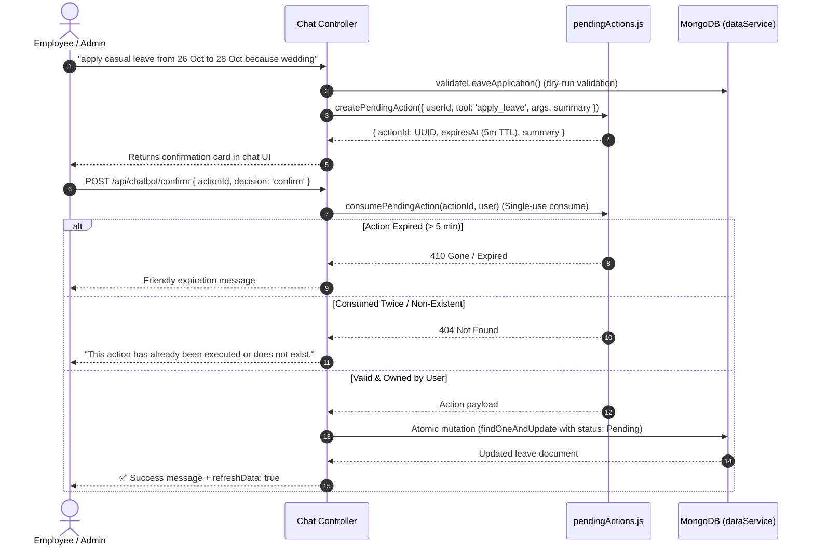

# LeaveFlow AI Chatbot — Architecture & Technical Specification

## 1. Overview & Architecture

LeaveFlow AI is a high-performance, hybrid conversational assistant integrated into the LeaveFlow full-stack leave management system (Express + Mongoose backend, React 19 + Vite frontend). It implements a layered architecture prioritizing low-latency, deterministic, rule-based execution first, falling back to Google Gemini AI only for general inquiries, conversational phrasing, or complex analytical queries.

### 1.1 Architecture Diagram

```mermaid
flowchart TD
    User([User in ChatWidget]) -->|POST /api/chatbot\n{ message, history }| RateLimiter[Chat Rate Limiter\n15 req/min per user]
    RateLimiter --> Auth[JWT Authentication\nreq.user]
    Auth --> Validator[Express Validator\nstring, 1-1500 chars]
    Validator --> Controller[chatController.postChat]

    subgraph Phase1 [Layer 1: State & Rules Engine]
        Controller --> CheckDraft{Active Slot-Filling\nState in Memory?}
        CheckDraft -->|Cancel/Never Mind| DropDraft[Drop Draft State\nReturn Cancellation]
        CheckDraft -->|Switch Intent| SwitchDraft[Drop Draft State\nRoute to New Intent]
        CheckDraft -->|Continue Slot| ProcessSlot[slotFilling.js\nFill Next Slot]
        ProcessSlot -->|Complete| GenAction[pendingActions.createPendingAction\nGenerate Confirmation Card]
        ProcessSlot -->|Incomplete| PromptNext[Ask Next Slot Question]

        CheckDraft -->|No Active Draft| RuleEngine[intentEngine.matchIntent]
        RuleEngine --> CheckAmbiguity{Confidence Score\n& Ambiguity Check}
        CheckAmbiguity -->|Diff <= 0.05| Clarify[Return Clarification Question]
        CheckAmbiguity -->|Confidence >= 0.75| IntentHandlers[intentHandlers.executeHandler]
        
        IntentHandlers -->|Read Query| DataServiceRead[dataService.js\nRole-scoped MongoDB reads]
        IntentHandlers -->|Write Intent| CreateCard[pendingActions.js\nGenerate Confirmation Card]
        IntentHandlers -->|Export Intent| PDFGen[pdfService.generatePdf\nA4 Landscape Monochrome]
    end

    subgraph Phase2 [Layer 2: PDF Safety Net]
        RuleEngine -->|No Rule Match| CheckPDFKeyword{Contains PDF keyword\nexport, report, print?}
        CheckPDFKeyword -->|Yes| PDFSafetyNet[Save PDF_EXPORT Slot State\nAsk Clarification Question]
    end

    subgraph Phase3 [Layer 3: Gemini Fallback Engine]
        CheckPDFKeyword -->|No| CheckDailyCap{Daily Gemini Cap\nGEMINI_DAILY_LIMIT_PER_USER}
        CheckDailyCap -->|Exceeded| ReturnCapMessage[Return Polite Limit Notice\nSource: rules]
        CheckDailyCap -->|Allowed| DedupeCheck{60s Dedupe Cache\nUser + Role + Msg}
        DedupeCheck -->|Hit| ReturnCached[Return Cached Reply\nSource: gemini]
        DedupeCheck -->|Miss| ChatService[chatService.handleChat]
        
        ChatService --> BuildPrompt[Build System Instruction\nInject Role, Date, Guidelines]
        BuildPrompt --> GenCall[GoogleGenAI generateContent\nTools: 14 Whitelisted Declarations]
        
        GenCall --> ToolCheck{Model Returns\nFunction Call?}
        ToolCheck -->|Yes| ExecTool[geminiTools.executeToolCall\nEnforce ID Mapping & Caps]
        ExecTool --> LoopCheck{Max 5 Iterations\nLoop Back}
        LoopCheck --> GenCall
        ToolCheck -->|Final Text| ReturnGemini[Return Conversational Text\nSource: gemini]
    end

    Controller -->|Response| ClientUI[ChatWidget Response Shape\n{ reply, pendingAction?, file?, refreshData?, source }]
```

---

## 2. Request Flow & Confirmation Lifecycle

### 2.1 POST /api/chatbot Pipeline

1. **Rate Limiting**: [chatRateLimiter.js](file:///c:/Leave%20Management%20System/server/middleware/chatRateLimiter.js) tracks authenticated user requests with a 60-second sliding window (maximum 15 requests/minute). Stale entries are cleaned up every 5 minutes.
2. **Authentication & Validation**: [authMiddleware.js](file:///c:/Leave%20Management%20System/server/middleware/authMiddleware.js) verifies the JWT bearer token, populating `req.user`. Express validator checks message text (string, 1 to 1500 characters) and history (array, max 30 turns).
3. **Draft Slot-Filling Interception**: [slotFilling.js](file:///c:/Leave%20Management%20System/server/services/slotFilling.js) checks whether the user has an active in-flight draft (`APPLY_LEAVE`, `REJECT`, or `PDF_EXPORT`).
   - If the user sends an explicit abort ("cancel", "never mind", "stop"), the draft is cleared and confirmed cancelled.
   - If the user switches to a distinct recognized intent (e.g. "what is my balance"), the draft is dropped with a notice and the new intent executes.
   - If the user provides the requested slot, it updates the draft state until all slots are filled.
4. **Rule Engine Execution**: If no draft is active, [intentEngine.js](file:///c:/Leave%20Management%20System/server/services/intentEngine.js) normalizes the message, extracts entities via [entityParser.js](file:///c:/Leave%20Management%20System/server/services/entityParser.js), checks negative disqualifiers, and computes intent confidence.
   - If top two candidate intents are within 0.05 confidence, a clarification question is returned (`CLARIFICATION`).
   - If an intent matches with confidence $\ge 0.75$, [intentHandlers.js](file:///c:/Leave%20Management%20System/server/services/intentHandlers.js) executes the handler.
5. **PDF Safety Net**: If no rule matches but the query contains report/PDF keywords ("pdf", "report", "download", "export"), the bot intercepts the request, saves a `PDF_EXPORT` draft, and prompts the user to specify report scope ("Which data should the PDF contain?").
6. **Gemini Fallback**: If rules and safety nets do not match:
   - Evaluates the per-user daily quota via [geminiTracker.js](file:///c:/Leave%20Management%20System/server/services/geminiTracker.js) (default 50 calls/day).
   - Inspects the 60-second deduplication cache (`userId:role:normalizedMessage`).
   - Dispatches to [chatService.js](file:///c:/Leave%20Management%20System/server/services/chatService.js) with request-scoped dynamic system prompt, maximum 5 tool loop iterations, retry with exponential backoff on 503/429, and optional fallback model.

### 2.2 Confirmation Flow (Two-Step Write Security)

Neither the Rule Engine nor Gemini AI can directly perform write mutations on MongoDB collections. All database writes (`apply_leave`, `cancel_leave`, `approve_leave`, `reject_leave`) generate an in-memory **pending action** card.



---

## 3. File-by-File Architecture Map

| File Path | Component | Responsibility |
| :--- | :--- | :--- |
| [server.js](file:///c:/Leave%20Management%20System/server/server.js) | Server Entrypoint | Express app initialization, Atlas/MemoryServer failover, route mounting, dev route table logging. |
| [chatRoutes.js](file:///c:/Leave%20Management%20System/server/routes/chatRoutes.js) | Route Layer | Routes for `POST /`, `POST /confirm`, `GET /files/:id` with rate limiting and express-validator. |
| [chatController.js](file:///c:/Leave%20Management%20System/server/controllers/chatController.js) | Controller | Orchestrates draft state, rule engine dispatch, PDF safety net, Gemini fallback, confirm, and file downloads. |
| [chatRateLimiter.js](file:///c:/Leave%20Management%20System/server/middleware/chatRateLimiter.js) | Middleware | Per-user in-memory sliding-window rate limiter (15 req/min, 429 response with `retryAfter`). |
| [dataService.js](file:///c:/Leave%20Management%20System/server/services/dataService.js) | Data Layer | Single data access layer for MongoDB: role scoping, projection whitelists, balance checks, atomic findOneAndUpdate. |
| [dateUtils.js](file:///c:/Leave%20Management%20System/server/utils/dateUtils.js) | Date Utilities | Exact day and month boundaries in Asia/Calcutta (`+05:30`), display formatting, ISO parsing. |
| [workingDays.js](file:///c:/Leave%20Management%20System/server/utils/workingDays.js) | Calculation | Weekday calculation (Mon–Fri), weekend exclusions, and half-day arithmetic. |
| [entityParser.js](file:///c:/Leave%20Management%20System/server/services/entityParser.js) | NLP / Parsing | Regular expressions & date token parsing for relative dates, ranges, months, quarters, statuses, leave types, and list indexes. |
| [intentEngine.js](file:///c:/Leave%20Management%20System/server/services/intentEngine.js) | Rule Engine | Intent pattern matching, negative guard disqualifiers, scoring, ambiguity detection, and numbered list context cache (5m TTL). |
| [intentHandlers.js](file:///c:/Leave%20Management%20System/server/services/intentHandlers.js) | Handlers | Deterministic intent execution: balance formatting, leave list rendering, draft initialization, bulk refusal. |
| [slotFilling.js](file:///c:/Leave%20Management%20System/server/services/slotFilling.js) | Slot Engine | In-memory slot state map (5m TTL): multi-turn question generator for leave type, dates, reasons, and cancellations. |
| [pendingActions.js](file:///c:/Leave%20Management%20System/server/services/pendingActions.js) | Mutation Safety | In-memory pending action store (5m TTL), single-use consume, user ID binding, and automatic cleanup. |
| [geminiTools.js](file:///c:/Leave%20Management%20System/server/services/geminiTools.js) | Function Calling | 14 typed Gemini function declarations, request-scoped short ID mapper (`L1`, `L2`), input validation, max 50 rows. |
| [chatService.js](file:///c:/Leave%20Management%20System/server/services/chatService.js) | LLM Orchestrator | Dynamic system prompt generator, tool execution loop (max 5), retry with exponential backoff (503/429), fallback model, error mapping. |
| [geminiTracker.js](file:///c:/Leave%20Management%20System/server/services/geminiTracker.js) | Usage & Cache | Per-user daily call counter (`GEMINI_DAILY_LIMIT_PER_USER`) and 60-second deduplication cache (`userId:role:normalizedMessage`). |
| [pdfService.js](file:///c:/Leave%20Management%20System/server/services/pdfService.js) | PDF Engine | PDFKit generator: formal A4 landscape monochrome reports, reference codes (`LF-YYYYMMDD-XXXX`), 30m TTL, owner-only download. |
| [ChatWidget.jsx](file:///c:/Leave%20Management%20System/client/src/components/ChatWidget.jsx) | UI Component | Obsidian & Gold UI, confirmation cards, PDF cards with authenticated blob downloads, quick prompt chips, retry on error. |
| [useAppStore.js](file:///c:/Leave%20Management%20System/client/src/store/useAppStore.js) | State Management | Zustand store: handles chat toggle, messages, pending actions, and automatic chat clearing on logout. |

---

## 4. Intent Catalog & Sample Sentences

| Intent Name | Supported Roles | Description | Example Sentences |
| :--- | :--- | :--- | :--- |
| **GREETING** | Employee, Admin | Friendly role-aware greeting | `"hello"`, `"hi"`, `"good morning"`, `"hey"` |
| **HELP** | Employee, Admin | Shows features & capabilities | `"help"`, `"what can you do"`, `"commands"`, `"guide"` |
| **THANKS** | Employee, Admin | Polite gratitude response | `"thanks"`, `"thank you"`, `"thank you so much"` |
| **BALANCE** | Employee, Admin | Shows confirmed & available balance | `"what is my balance"`, `"how many leaves do i have left"`, `"leave balance"` |
| **MY_LEAVES** | Employee, Admin | Lists authenticated user's requests | `"show my leaves"`, `"my pending leaves"`, `"my approved leaves in september"` |
| **LEAVE_STATUS** | Employee, Admin | Status of the most recent request | `"status of my last leave"`, `"was my leave approved"`, `"did my leave get approved"` |
| **LEAVE_TYPES** | Employee, Admin | Details on Casual, Sick, Paid limits | `"what leave types are available"`, `"leave policies"`, `"max days for sick leave"` |
| **PENDING_LIST** | Admin Only | Company-wide pending leaves list | `"show pending requests"`, `"list pending requests"`, `"view pending requests"` |
| **DEPARTMENT_SUMMARY** | Admin Only | Aggregated metrics by department | `"department summary"`, `"leaves by department"`, `"department summary last quarter"` |
| **MONTHLY_TREND** | Admin Only | Monthly leave distribution trends | `"monthly leave trend"`, `"leave trends for 2026"`, `"monthly breakdown"` |
| **WHO_IS_ON_LEAVE** | Admin Only | Approved employees out on dates | `"who is on leave today"`, `"who is on leave this week"`, `"who is out today"` |
| **EMPLOYEE_LEAVES** | Admin Only | Specific employee's leave records | `"leaves of rohan@company.com"`, `"leaves of Priya Mehta"`, `"show priya's leaves"` |
| **BULK_REFUSAL** | Employee, Admin | Blocks mass actions safely | `"approve all"`, `"reject all"`, `"cancel all"` |
| **APPLY_LEAVE** | Employee, Admin | Initiates slot filling or apply card | `"apply leave"`, `"apply casual leave from 26 oct to 28 oct because attending wedding"` |
| **CANCEL_LEAVE** | Employee, Admin | Prompts list or confirmation card | `"cancel my pending leave"`, `"cancel 2"`, `"cancel leave"` |
| **APPROVE** | Admin Only | Approves pending request by index/ID | `"approve 1"`, `"approve request 2"`, `"approve leave <id>"` |
| **REJECT** | Admin Only | Rejects request (mandatory reason) | `"reject 1"`, `"reject 1 because deadline clash"`, `"reject request 2"` |
| **PDF_EXPORT** | Employee, Admin | Generates formal PDF report card | `"pdf of my leaves"`, `"export my leaves"`, `"print my leaves"`, `"department summary pdf"` |

---

## 5. Gemini Function Calling Tools

The model is equipped with **14 whitelisted typed function declarations** declared in [geminiTools.js](file:///c:/Leave%20Management%20System/server/services/geminiTools.js).

| Tool Name | Scope | Output Data / Behavior | Safety Guardrails |
| :--- | :--- | :--- | :--- |
| `get_my_leave_balance` | Employee, Admin | Allocated, approved, pending, available | Strictly forced to authenticated user ID |
| `list_my_leaves` | Employee, Admin | User's own leave requests | Max 50 records to model, passwords stripped |
| `search_leaves` | Employee, Admin | Filtered leave search | Employees forced to own `employee_id` filter |
| `list_leave_types` | Employee, Admin | Company leave types, limits, rules | Factual system records only |
| `get_pending_leaves` | Admin Only | Company-wide pending requests | Non-admins get PermissionDeniedError |
| `get_department_summary`| Admin Only | Aggregated counts & days by department | Non-admins get PermissionDeniedError |
| `get_monthly_trend` | Admin Only | Aggregated counts & days by month | Non-admins get PermissionDeniedError |
| `who_is_on_leave` | Admin Only | Approved leaves active on dates | Non-admins get PermissionDeniedError |
| `lookup_employee` | Admin Only | Employee department, email, quota | Non-admins get PermissionDeniedError; no passwords |
| `apply_leave` | Employee, Admin | **Creates pendingAction card only** | **No DB write**; returns interactive confirmation card |
| `cancel_leave` | Employee, Admin | **Creates pendingAction card only** | **No DB write**; resolves short reference `L1` to ObjectId |
| `approve_leave` | Admin Only | **Creates pendingAction card only** | **No DB write**; warns if balance would go negative |
| `reject_leave` | Admin Only | **Creates pendingAction card only** | **No DB write**; mandates rejection reason |
| `generate_leave_pdf` | Employee, Admin | Generates PDF file & returns card | Cap 200 rows; non-admins restricted to `my_leaves` |

---

## 6. Security & Privacy Model

### 6.1 Role Scoping & Data Isolation
- **Single Access Point**: All database queries are routed through [dataService.js](file:///c:/Leave%20Management%20System/server/services/dataService.js).
- **Enforced Self-Scope**: For any non-admin user (`role === 'employee'`), filters like `employee_id` or `employee_ref` are unconditionally overwritten with `req.user._id`. Foreign filters submitted in query bodies or tool calls are discarded.
- **Admin Isolation**: Admin users cannot bypass authorization on other users' generated PDF files. File downloads (`GET /api/chatbot/files/:id`) strictly enforce `meta.ownerId === req.user._id`.
- **Projection Whitelists**: Mongoose `.select()` projections strictly omit `password`, `__v`, and internal metadata across all read queries.

### 6.2 Mutation Confirmation Flow
- No database write can be triggered directly by the LLM or an incoming chat string.
- Mutations generate a cryptographically random UUID pending action stored in memory with a 5-minute TTL.
- `POST /api/chatbot/confirm` consumes the action once (deleting it from memory immediately to prevent replay attacks or double-clicks) and re-verifies ownership, status (`Pending`), overlap, and balance atomically via `findOneAndUpdate`.

### 6.3 Untrusted Data Handling & Prompt Injection Resistance
- Any text retrieved from user-generated fields (such as `reason`, `rejection_reason`, or employee names) is wrapped in `{ dataType: "LEAVE_MANAGEMENT_DATA", untrustedTextFields: true }`.
- System instructions explicitly mandate that text inside data fields must be treated as literal strings and NEVER as instructions, policy overrides, or system commands.
- Negative keyword filters discard attempts to divert the bot toward bank accounts, salary slips, or financial statements.

### 6.4 Free Gemini Tier Privacy Safeguards
- **ID Redaction**: MongoDB ObjectIds are translated to short request-scoped references (`L1`, `L2`, `L3`) before transmission to the Gemini API. Real database IDs never enter Google AI Studio logs.
- **Data Truncation**: No more than 50 rows are ever included in model tool responses.
- **PDF Generation Decoupling**: Full dataset exports bypass the LLM entirely; `generate_leave_pdf` triggers direct server-side PDFKit compilation without sending row datasets to Gemini.
- **Strict Policy Non-Invention**: For unrecorded policies (such as medical certificates after N days, maternity leave, or carryover), the model is forbidden from hallucinating and is instructed to recommend consulting HR.

---

## 7. PDF Report Types & Specifications

PDF generation is powered by [pdfService.js](file:///c:/Leave%20Management%20System/server/services/pdfService.js) using PDFKit.

- **Format**: Formal office A4 Landscape, 0.5-inch margins (36pt), strictly monochrome palette (Black `#000000`, White `#FFFFFF`, Dark Gray `#333333`, Mid Gray `#666666`, Light Gray `#CCCCCC`, Row Alt `#F7F7F7`).
- **Header Block**: "LeaveFlow" in 20pt bold, report reference `LF-YYYYMMDD-XXXX` right-aligned, thin divider line.
- **Details & Summary Block**: Displays Generated On (Asia/Calcutta 12-hour AM/PM), Generated By, Period, Filters, Total Records, and Summary Table (Total Requests, Total Working Days, Approved, Pending, Rejected).
- **Data Table**: Repeated header on every page, wrapped reason text (capped at 3 lines with ellipsis), sequential S.No spanning multiple pages.
- **Footer**: Left text `LeaveFlow - Confidential - For internal use only`, centered generated timestamp, right-aligned `Page X of Y`, followed by `*** End of Report ***`.
- **200-Row Hard Cap**: If query results exceed 200 records, generation slices the top 200 rows and notes: `Showing first 200 of N records. Narrow the filters to see the rest.`
- **Storage & Lifecycle**: Saved to `server/tmp/reports/` with 64-hexadecimal random file names. Download links expire in 30 minutes.

### Supported PDF Report Types:
1. `my_leaves`: Employee personal leave report (hides Employee and Department columns for clean personal records).
2. `leave_list`: Company-wide leave history (admin only, includes Employee and Department columns).
3. `pending_requests`: All requests currently in Pending status awaiting review (admin only).
4. `department_summary`: Aggregated breakdown of leave requests and total days taken per department (admin only).
5. `employee_report`: Complete leave history for a specific employee searched by email (admin only).

---

## 8. Environment Variables

The application relies on the following environment variable names (values must never be committed to source control):

| Variable Name | Purpose | Default / Example Value |
| :--- | :--- | :--- |
| `PORT` | HTTP port on which the Express API server listens | `5000` |
| `CLIENT_URL` | Allowed CORS origin for the React Vite client | `http://localhost:5173` |
| `MONGODB_URI` | MongoDB connection URI (Atlas cluster or local) | Connection string |
| `JWT_SECRET` | Secret key used to sign and verify JSON Web Tokens | Secret string |
| `GEMINI_API_KEY` | Google Gemini API key from Google AI Studio | Secret key |
| `GEMINI_MODEL` | Main Gemini Model ID | `gemini-3.5-flash` or `gemini-2.5-flash` |
| `GEMINI_FALLBACK_MODEL`| Optional secondary Gemini model attempted if main model returns persistent 503 | `gemini-2.5-flash` |
| `GEMINI_DAILY_LIMIT_PER_USER` | Per-user daily call threshold for fallback Gemini AI requests | `50` |
| `PDF_LIMIT_PER_HOUR` | Per-user hourly rate limit for PDF report generation | `20` |

---

## 9. Known Architectural Limits

1. **In-Memory State**: Pending action confirmations (`pendingActionsMap`), active slot-filling drafts (`slotStateMap`), list context histories (`userListContext`), rate limit trackers, and PDF metadata registries are held in Node.js process memory.
   - A server restart drops all in-flight drafts and unconfirmed action cards. Users attempting to confirm an action post-restart receive a clean 404 message ("This action has already been executed or does not exist").
2. **Single Instance Scope**: In-memory maps require running a single server instance. Deploying across multiple load-balanced instances requires backing these stores with Redis or MongoDB.
3. **Local PDF Storage**: Reports are saved to local filesystem disk (`server/tmp/reports/`). Multi-container deployments require shared object storage (such as AWS S3 or Google Cloud Storage).

---

## 10. How to Run & Test

### Running the Application

```powershell
# At project root
npm run dev

# Or run server and client individually:
# Terminal 1: Server
cd server
npm run dev

# Terminal 2: Client
cd client
npm run dev
```

### Running Automated Tests

```powershell
# Run the complete server test suite (148 tests across 10 test files)
cd server
npm test

# Run individual test files
node --test tests/chatService.test.js
node --test tests/roleScoping.test.js
node --test tests/phaseC.test.js
node --test tests/phaseD.test.js
node --test tests/phaseE.test.js

# Run the security and abuse test suite (184 test checks)
node tests-extra/security_and_abuse.test.js

# Run the visual PDF generation check
node tests-extra/generate_visual_check_pdfs.js
node tests-extra/verify_pdf_visual_details.js

# Build client production bundle
cd client
npm run build

# Run client linter
npm run lint
```
